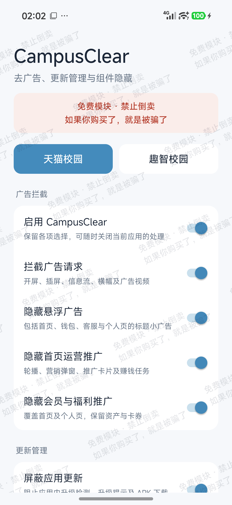
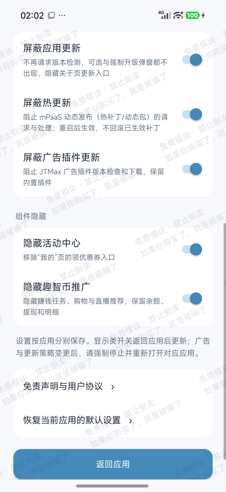
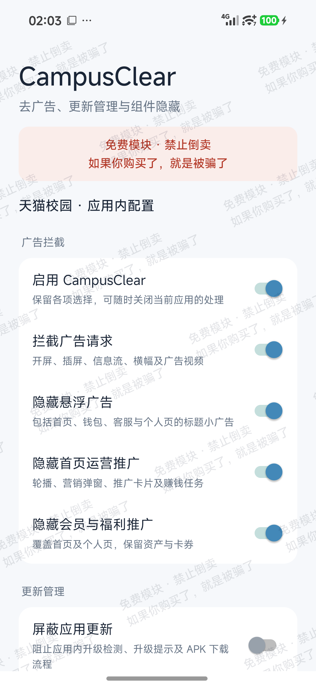

# CampusClear · 天猫校园 & 趣智校园去广告

免费去广告模块，提供广告拦截、更新管理和界面组件隐藏，可按应用分别设置。

**旧版源码已丢失，本次是重新编写的 CampusClear。** 当前版本为 **1.9.2 / versionCode 20**，包名为 `com.xjyh.noads`。本仓库沿用历史地址，旧模块 `com.puretools.campus` 的 2.0 与新版本使用不同包名，**不能直接覆盖升级**，旧配置也不会自动迁移。

[下载本次发布](https://github.com/xiaojie-yahu/TmallCampus-AdBlock/releases/tag/20-1.9.2) · [问题反馈](https://github.com/xiaojie-yahu/TmallCampus-AdBlock/issues)

## 学生不是韭菜

做这个项目，源于我自己的使用体验：学校要求使用指定的校园软件，想换一个替代品并不容易。我已经为校园服务充值，却还得在广告和推广里找功能，普通操作也会被反复打断。

广告满天飞、弹窗一层接一层，用起来像被广告软件缠住了一样。这种体验真的让人难受、反感，甚至觉得恶心。学生不该因为必须使用某个软件，就被当成可以反复收割的流量。

我理解运营需要成本，也理解合理商业化，适度的开屏广告可以接受。广告应当有分寸，不能妨碍正常使用。这个模块希望把清爽的使用体验和选择权还给学生。

## 支持版本

| 应用 | 包名 | 本次核对版本 | 使用方式 |
| --- | --- | --- | --- |
| 天猫校园 | `com.tmall.campus.and` | **5.8.0**（50008000） | 原版 + LSPosed 模块，或免 Root 内置版 |
| 趣智校园 | `com.klcxkj.zqxy` | **6.5.30**（680） | 原版 + LSPosed 模块 |

适配以以上版本为准，其他版本未验证。旧版发布记录中的 5.0.0 / 6.5.21 不代表本次重写版的适配结论。

## 下载哪个 APK

本次 [Release](https://github.com/xiaojie-yahu/TmallCampus-AdBlock/releases/tag/20-1.9.2) 提供以下四个文件：

| 文件 | 用途 |
| --- | --- |
| `CampusClear-v1.9.2.apk` | 独立模块，配合 Root 和支持 **libxposed API 102** 的 LSPosed 框架使用 |
| `TmallCampus_5.8.0_CampusClear_1.9.2_NPatch.apk` | 天猫校园免 Root 内置版，已集成同一份 CampusClear 1.9.2 |
| `TmallCampus_5.8.0_Original.apk` | 天猫校园原版 APK，未内置模块，供 LSPosed 方案使用 |
| `QuzhiCampus_6.5.30_Original.apk` | 趣智校园原版 APK，未内置模块，供 LSPosed 方案使用 |

趣智内置版有启动失败记录，**本次不提供**，请使用原版配合 LSPosed。

## 主要功能

- **广告拦截**：处理开屏、插屏、信息流、横幅等广告请求，以及悬浮广告、首页运营推广。
- **更新管理**：分别控制应用升级提示、热更新及广告插件更新；不会回滚已经生效的补丁。
- **天猫校园精简**：按需隐藏会员推广、推荐商品、附近门店、AI 悬浮助手、快捷入口、个人页部分区域，以及商城 / 找搭子 / 小红花入口。
- **趣智校园精简**：隐藏活动中心和趣智币推广，保留余额、提现、明细等业务入口。
- **应用内配置**：可以从目标应用设置中的 CampusClear 入口调整当前应用，也可在独立模块中分别设置两款应用。
- **免费声明**：设置界面带有免费使用与禁止倒卖提示；发布包已进行 R8 混淆及字符串处理。

组件隐藏只改变界面展示，不删除订单、资产或领取记录。功能效果受应用版本、服务端内容和设置影响。

## 实机截图

以下为本次从测试手机直接取得的设置界面截图；开关状态仅代表截图时的配置。

| 独立模块设置 | 趣智更新管理与组件隐藏 | 天猫校园内配置 |
| :---: | :---: | :---: |
|  |  |  |

## 安装与使用

### Root / LSPosed 方案

1. 安装上表对应版本的**原版**应用。
2. 安装 `CampusClear-v1.9.2.apk`。模块本身要求 Android 8.0+，框架需支持 **libxposed API 102**。
3. 在 LSPosed 中启用 CampusClear，勾选天猫校园与趣智校园作用域。
4. 旧用户请先停用旧的 `com.puretools.campus` 模块，避免重复处理；新模块需要单独安装并重新启用作用域。
5. 打开 CampusClear 或目标应用中的配置入口，按需调整；广告与更新策略变更后，强制停止并重新打开对应应用。

### 天猫校园免 Root 内置版

- 使用 NPatch 1.1.0（857）集成 CampusClear 1.9.2，不需要 Root 或另装 LSPosed；安装包要求 **Android 9.0+、arm64**。
- **内置版与原版签名不同，不能直接覆盖安装。** 切换前请备份可备份的数据、确认账号能重新登录；卸载原版会清除其本地数据。
- 原版与内置版包名相同，不能同时安装。对内置版不要再叠加 LSPosed 中的 CampusClear。
- 本地真机记录已验证天猫内置版能够启动并加载模块；不代表所有机型或所有业务功能均已验证。

## 免费与下架承诺

- 仅供学习交流，完全免费，**禁止商业化、付费倒卖、插入广告或推广**。如果你付费获取了本模块，请停止向售卖者付款。
- 尊重应用的合理商业化，也希望减少影响正常使用的广告与推广。**若天猫校园或趣智校园官方主动减少广告投放、优化用户体验，我们将第一时间下架模块并删除本仓库。**
- 若本项目自身出现商业化、插入广告或推广等行为，也将立即下架并删除仓库。

## 使用说明

这是非官方项目，与目标应用运营方无关。第三方原版 APK 的权利归各自权利人所有，优先使用官方渠道；此处提供的是本次适配版本的安装包。

使用模块或改签名内置版可能导致兼容性、登录或业务功能异常。请保留可恢复的原版安装包，遇到问题先停用模块排查，再到 Issues 提供应用版本、模块版本、安装方式和复现步骤，避免提交账号、手机号、订单或令牌。

当前仓库发布 APK 与使用说明，未提供本次重写版的源码。

关键词：天猫校园去广告、趣智校园去广告、智趣校园去广告、CampusClear、LSPosed、Xposed、TmallCampus、QuzhiCampus。
